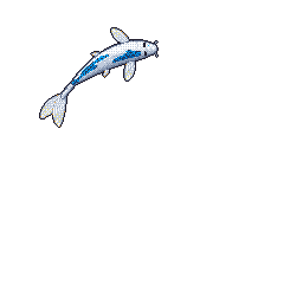

<!--
**anurag-nandurkar/anurag-nandurkar** is a ✨ _special_ ✨ repository because its `README.md` (this file) appears on your GitHub profile.

Here are some ideas to get you started:

- 🔭 I’m currently working on ...
- 🌱 I’m currently learning ...
- 👯 I’m looking to collaborate on ...
- 🤔 I’m looking for help with ...
- 💬 Ask me about ...
- 📫 How to reach me: ...
- 😄 Pronouns: ...
- ⚡ Fun fact: ...
-->
<h1 align="center">Hi, I'm Anurag 👋</h1>

  

  Building at Brightplus · Pune, India

  <a href="https://www.linkedin.com/in/anurag-work/">LinkedIn</a> ·
  <a href="https://dragify.brightplus.pro">Dragify</a>

## 🚀 Featured project

### [Dragify](https://dragify.brightplus.pro)
Export documentation made simple: create documents, share them as forms, and collect responses in one place.

## 🛠️ Tech I work with

## 📫 Reach me
[LinkedIn](https://www.linkedin.com/in/anurag-work/)
